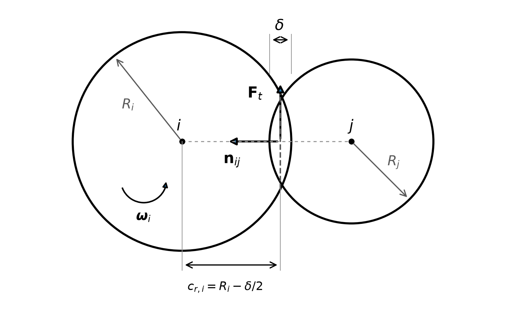
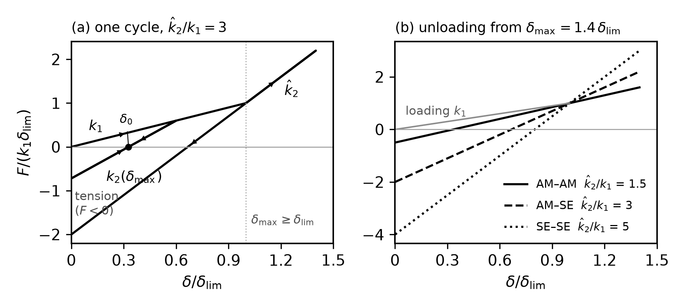

# DEM 지배방정식 — 문헌 배경과 LIGGGHTS 3.8.0 구현

**이산요소법 (discrete element method) 으로 푼 고체전해질 복합양극 압축 모델 (ps45 덱) 의 운동방정식 · 접촉 법칙 정리**

> 2026-10-11 · 배경 조사 보고서 (내부용 · 검토 전 초안)
>
> 근거 고정 — 코드: LIGGGHTS-PUBLIC 3.8.0, git 3d5c00f2 (2024-06-07) · 덱: `in.ps_7_3_r45.liggghts` (sha256 `69f4359c…`, ps45 다섯 조성 덱의 재료 · 접촉 · 적분 줄은 서로 같음) · 문헌: 원문 PDF 로 정리한 연구실 문헌 데이터베이스 (litdb)

## 요약

- 우리 압축 모델은 **연성 구 이산요소법** (soft-sphere discrete element method, DEM) 이다. 입자는 형상이 변하지 않는 구이고, 접촉에서의 국소 변형은 두 구의 **겹침 δ** 로 나타낸다. 뉴턴–오일러 운동방정식을 속도 Verlet 방식으로 적분한다.
- 법선 접촉력은 **선형 이력 스프링** (LIGGGHTS `hooke/hysteresis`) 이다. 적재 강성 $k_1$, 제하 · 재적재 강성 $k_2(\delta_{\max})$, 점착 강성 $k_c$, 소성 깊이 $\phi_F$ 로 정의되며, Luding (2008) [1] 의 탄소성 · 점착 선형 모델과 같은 꼴이다.
- 접선력은 접선 변위를 누적하는 스프링에 Coulomb 마찰 한계를 둔 모델 (`tangential history`), 구름 저항은 크기가 일정하고 방향만 상대 회전을 따르는 토크 모델 (`rolling_friction cdt`) 이다.
- 적재 강성 $k_1$ 은 영률 · 환산 반경 · 환산 질량 · 특성 충돌속도 $V$ 로 정해진다. 이는 속도 $V$ 의 Hertz 충돌과 **같은 최대 겹침**을 주는 선형 강성이다 (부록 C-1 유도). 준정적 압축에서 $V$ 는 충돌속도가 아니라 강성을 정하는 입력값으로 작동한다.
- 덱 값을 대입하면 포화 겹침은 $\delta_{\lim}/2R^* = 0.15$ (AM–AM) · $0.015$ (AM–SE) · $0.006\,25$ (SE–SE) 이다. $k_c/k_1 = 10^5$–$10^6$ 이라 제하 직선은 $\delta \to 0$ 직전까지 인장 쪽으로 이어진다. 시간 간격은 Rayleigh 시간의 0.7–1.6 % 이다 (모두 산술 · 런 로그 대조 전).
- 한계: 입자 형상 변형은 표현하지 않는다 (MPM 이 보완). 압축 단계의 전역 점성 감쇠가 판 반력의 큰 몫을 차지한다 (원장 `DEMP-01`). SE 유효 영률 1.35 GPa 는 보정 입력값이며 이 보고서는 그 타당성을 검증하지 않는다.

## 1. 서론

### 1.1 배경과 목적

복합양극 압축 DEM 의 결과 (공극률 · 두께 · 접촉망 · 하중 분담) 는 어떤 접촉 법칙을 쓰는지에 직접 묶여 있다. 발표 자료에는 문헌의 **기본형 지배방정식**을 싣고 (감쇠 · 점착 등을 뺀 깨끗한 꼴), 코드가 실제로 푸는 **구현식**은 따로 정리해 두는 것이 원칙이다 (`docs/dem_governing_equations_report_20261009.md`). 이 보고서는 두 가지를 한 문서에서 연결한다.

1. 각 식이 문헌에서 어디서 왔는지 (모델 계보와 대표 문헌).
2. LIGGGHTS 3.8.0 이 그 식을 어떤 꼴로 구현하는지 (설명서 · 소스 줄).
3. 우리 덱의 값을 넣었을 때 어떤 크기가 되는지 (산술).

### 1.2 범위

- 대상: ps45 압축 덱 (P:S = 7:3 을 대표로 · 다섯 조성 덱은 조성 · 시드만 다름) — `docs/reviews/codex_ps45_porosity_evidence_20261001/reference/dem_scripts/ps_sweep_6mah_20260914/in.ps_7_3_r45.liggghts`.
- 다루는 것: 운동방정식, 시간적분과 시간 간격, 접촉 기하, 법선 · 접선 · 구름 접촉력, 감쇠, 벽 · 판 경계, 압축 절차.
- 다루지 않는 것: 접촉망 전도도 계산 (수송), MPM (물질점법) 연속체 모델, 입자 파괴 모델.

### 1.3 근거 자료와 표기

| 표지 | 뜻 | 위치 |
|---|---|---|
| [설명서] | LIGGGHTS-PUBLIC 3d5c00f 의 `doc/` 쪽 | 부록 B · 이 보고서 자료 폴더 |
| [소스] | 같은 커밋의 `src/` 파일 · 줄 번호 | 부록 B |
| [덱] | ps45 7:3 덱의 줄 번호 | 부록 B |
| [산술] | 이 보고서가 식 · 덱 값으로 계산 · 유도한 것 | 부록 C |
| [n] | 참고문헌 번호 | 참고문헌 |

- 단위 · 축척: 덱은 `units si` 이지만 반지름 × 1000 · 영률 × 0.001 · 압력 × 0.001 의 축척 규약을 쓴다 ([덱] 3 · 25 행). 밀도는 축척하지 않는다. 따라서 덱의 길이 · 시간 · 힘 값은 실제 값과 1:1 로 대응하지 않는다. 이 보고서의 덱 단위 값은 "(덱)" 으로 표시한다.
- 기호: 부록 A.

## 2. DEM 의 기본 구조

### 2.1 연성 구 모델의 가정

연성 구 DEM 은 입자를 강체 구로 두고, 접촉에서의 국소 변형을 두 구의 겹침 $\delta=(a_i+a_j)-(\mathbf r_i-\mathbf r_j)\cdot\mathbf n$ ($\delta>0$ 일 때만 접촉) 으로 나타낸다. 접촉마다 힘–겹침 법칙으로 힘을 계산하고, 그 합으로 뉴턴 운동방정식을 시간적분한다 [1]. 이 방식은 Cundall–Strack (1979) 에서 비롯된 것으로, 리뷰 · 응용 연구들이 출발점으로 인용한다 [2, 3, 4].

- **겹침은 변형의 대리 변수다.** 입자 형상은 변하지 않으므로, 소성 흐름 · 빈틈 채움 같은 형상 변화는 접촉 법칙 (이력 · 강성 연화) 으로만 들어간다. 탄성 물성의 영향을 정리한 리뷰는 강성을 낮춰도 되는 조건으로 "particle overlap remains smaller than 1 % of the particle diameter" 를 들고, "The denser the system, the more important is the stiffness value" 라고 적는다 [2]. 보정 리뷰도 구속 일축 압축 시험이 입자 강성에만 민감했다고 정리한다 [5].
- **시간적분은 명시적이다.** 운동방정식 $m_i\ddot{\mathbf x}_i=\mathbf f_i+m_i\mathbf g$, $I_i\dot{\boldsymbol\omega}_i=\mathbf T_i$, $\mathbf T_i=\sum\mathbf l^c_i\times\mathbf f^c_i$ 꼴 [6, 7, 8] 을 Verlet 계열 방식으로 적분한다 [9]. 시간 간격은 접촉 지속 시간 $t_c=\pi/\omega$ 보다 충분히 작아야 한다 [1, 7].

### 2.2 LIGGGHTS 의 접촉 모델 사슬

LIGGGHTS ("LAMMPS improved for general granular and granular heat transfer simulations") 는 분자동역학 코드 LAMMPS 를 바탕으로 만든 오픈소스 DEM 코드다 ([설명서] `Section_intro` · 저장소 README) [10]. LIGGGHTS 와 LAMMPS 의 대표 문헌으로는 각각 Kloss et al. (2012) 와 Plimpton (1995) 이 인용된다 [7].

입자–입자 상호작용은 `pair_style gran` 한 줄에서 모델을 차례로 고른다 ([설명서] `pair_gran`).

```
pair_style gran model <법선> tangential <접선> cohesion <점착> rolling_friction <구름> surface <표면>
```

한 접촉에서의 계산 순서는 표면 (접촉 기하) → 법선 → 점착 → 접선 → 구름이다 ([소스] `contact_models.h` 228–237). 접선 모델의 Coulomb 한계와 구름 토크의 크기가 법선 모델의 결과 ($F_n$ · $k_n$) 를 쓰기 때문에 이 순서가 필요하다.

| 사슬 | 우리 덱 | 설명 |
|---|---|---|
| 법선 (model) | `hooke/hysteresis` | 선형 이력 스프링 + 점착 가지 + 접촉 감쇠 (5.3 절) |
| 접선 (tangential) | `history` | 접선 변위 누적 스프링 + Coulomb 한계 (6 절) |
| 점착 (cohesion) | 없음 | 점착은 법선 모델 안의 $k_c$ 가지로 들어간다 |
| 구름 (rolling_friction) | `cdt` | 일정 방향 토크 (7 절) |
| 표면 (surface) | 기본 (구) | 겹침 · 법선 · 상대속도 계산 (4 절) |

바닥 (평면) 과 판 (STL 메시) 접촉도 같은 모델 사슬을 쓴다 ([덱] 101 · 184 행).

### 2.3 한 시간 간격의 계산 순서

| 단계 | 내용 | 근거 |
|---|---|---|
| 1 | 속도 반 간격 갱신 · 위치 전진 · 각속도 반 간격 갱신 | [소스] `fix_nve_sphere.cpp` 138–181 |
| 2 | 이웃 목록 갱신 (bin 방식 · skin 0.002 (덱)) | [덱] 51–52 행 |
| 3 | 입자–입자 접촉력 · 토크 (모델 사슬) | [소스] `pair_gran_base.h` · `contact_models.h` |
| 4 | 벽 · 판 접촉력, 중력, 전역 점성 감쇠 | [소스] `fix_wall_gran_base.h` · `fix_viscous.cpp` 140–157 |
| 5 | 속도 · 각속도 나머지 반 간격 갱신 | [소스] `fix_nve_sphere.cpp` 208–244 |

## 3. 운동방정식과 시간적분

### 3.1 병진 · 회전 운동방정식

입자 $i$ (질량 $m_i$, 반지름 $R_i$) 의 병진 · 회전 운동은 다음과 같다.

$$
m_i\frac{d\mathbf{v}_i}{dt}=\sum_{j}\left(\mathbf{F}^{n}_{ij}+\mathbf{F}^{t}_{ij}\right)+\mathbf{F}^{w}_{i}+m_i\mathbf{g}-\gamma_g\mathbf{v}_i \tag{1}
$$

$$
I_i\frac{d\boldsymbol{\omega}_i}{dt}=\sum_{j}\left(-c_{r,i}\,\mathbf{n}_{ij}\times\mathbf{F}^{t}_{ij}-\mathbf{M}^{r}_{ij}\right)+\mathbf{T}^{w}_{i},\qquad I_i=\tfrac{2}{5}m_iR_i^{2} \tag{2}
$$

- $\mathbf{F}^{w}_{i}$ · $\mathbf{T}^{w}_{i}$: 벽 · 판 접촉의 힘 · 토크. $-\gamma_g\mathbf{v}_i$: 전역 점성 감쇠 (8.2 절).
- 접선력의 지렛대는 반지름 $R_i$ 가 아니라 **접촉 반지름** $c_{r,i}=R_i-\delta/2$ 이다 ([설명서] `gran_model_hooke` · [소스] `surface_model_default.h` 182–188 · `tangential_model_history.h` 230–261).
- 관성 모멘트 계수 0.4 는 소스의 상수다 ([소스] `fix_nve_sphere.cpp` 68).
- 기본형 (발표 슬라이드) 은 식 (1) 에서 $\mathbf{F}^{w}$ · $-\gamma_g\mathbf{v}$ 를, 식 (2) 에서 $\mathbf{M}^{r}$ 를 빼고 $c_{r,i}\to R_i$ 로 둔 꼴이다.

### 3.2 속도 Verlet 적분

`fix nve/sphere` 는 시간 간격 $\Delta t$ 를 둘로 나누어 적분한다 ([소스] `fix_nve.cpp` 85–86 · `fix_nve_sphere.cpp` 138–244).

$$
\begin{aligned}
\mathbf{v}_i^{\,n+1/2}&=\mathbf{v}_i^{\,n}+\frac{\Delta t}{2m_i}\mathbf{F}_i^{\,n}, &\quad
\boldsymbol{\omega}_i^{\,n+1/2}&=\boldsymbol{\omega}_i^{\,n}+\frac{\Delta t}{2I_i}\mathbf{T}_i^{\,n},\\
\mathbf{x}_i^{\,n+1}&=\mathbf{x}_i^{\,n}+\Delta t\,\mathbf{v}_i^{\,n+1/2}, & &\\
\mathbf{v}_i^{\,n+1}&=\mathbf{v}_i^{\,n+1/2}+\frac{\Delta t}{2m_i}\mathbf{F}_i^{\,n+1}, &\quad
\boldsymbol{\omega}_i^{\,n+1}&=\boldsymbol{\omega}_i^{\,n+1/2}+\frac{\Delta t}{2I_i}\mathbf{T}_i^{\,n+1}.
\end{aligned} \tag{3}
$$

- 구의 자세 (회전 각도) 는 적분하지 않는다. 구에서는 접촉 기하가 자세와 무관하기 때문이다.
- 접선 스프링 변위 $\boldsymbol{\xi}$ 와 최대 겹침 $\delta_{\max}$ 는 접촉마다 저장하는 **이력 변수**다 (5.3 · 6 절).

### 3.3 시간 간격

명시적 적분의 안정을 위해 시간 간격은 탄성파가 입자를 가로지르는 시간보다 충분히 작아야 한다. LIGGGHTS 는 두 기준을 제공한다 ([설명서] `fix_check_timestep_gran`).

$$
\Delta t_R=\frac{\pi R\sqrt{\rho/G}}{0.1631\,\nu+0.8766},\qquad
\Delta t_H=2.87\left(\frac{m^{*2}}{R^{*}E^{*2}v_{\max}}\right)^{1/5} \tag{4}
$$

여기서 $G=E/[2(1+\nu)]$ 는 전단 탄성률, $v_{\max}$ 는 최대 상대속도다. 우리 덱의 $\Delta t = 10^{-6}$ (덱) 을 상별 Rayleigh 시간과 비교하면 다음과 같다 [산술].

| 상 | $R$ (덱) | $\rho$ (kg m⁻³) | $E$ (덱) | $\nu$ | $\Delta t_R$ (덱) | $\Delta t/\Delta t_R$ |
|---|---|---|---|---|---|---|
| AM_P | $4.5\times10^{-3}$ | 4800 | $1.4\times10^{8}$ | 0.25 | $1.43\times10^{-4}$ | 0.70 % |
| AM_S | $2.0\times10^{-3}$ | 4800 | $1.4\times10^{8}$ | 0.25 | $6.34\times10^{-5}$ | 1.58 % |
| SE | $5.0\times10^{-4}$ | 2000 | $1.35\times10^{6}$ | 0.30 | $1.05\times10^{-4}$ | 0.95 % |

- 덱은 `fix check/timestep/gran` 을 쓰지 않는다 — 런 중에 Hertz 시간 기준은 점검되지 않았다.
- 축척 덱이므로 이 비율은 덱 안에서만 뜻이 있다 (덱의 시간축은 실제 시간이 아니다).

- 문헌의 관행: Rayleigh 시간의 10 % 미만 [6], 15 % [11], 20 % [12, 13], 20–30 % [14], 또는 $0.2\sqrt{m^{*}/k^{*}}$ [15]. 우리 덱 (0.7–1.6 %) 은 이 범위보다 작다.
- LIGGGHTS 사용 보고서는 `fix check/timestep/gran 1000 0.2 0.2` 로 Rayleigh · Hertz 기준을 런 중 점검하는 예를 보인다 [12]. 우리 덱에는 이 fix 가 없다.

## 4. 접촉 기하와 환산량

두 구 $i$ · $j$ 의 중심 거리를 $r_{ij}=\lVert\mathbf{x}_i-\mathbf{x}_j\rVert$ 라 하면 겹침 · 법선 단위벡터는 다음과 같다 ([소스] `pair_gran_base.h` 311–364 · `surface_model_default.h` 146–203).

$$
\delta_{ij}=R_i+R_j-r_{ij}\;(>0\text{ 이면 접촉}),\qquad
\mathbf{n}_{ij}=\frac{\mathbf{x}_i-\mathbf{x}_j}{r_{ij}} \tag{5}
$$

$$
\mathbf{v}_{ij}=\mathbf{v}_i-\mathbf{v}_j,\quad
v_n=\mathbf{v}_{ij}\cdot\mathbf{n}_{ij},\quad
\mathbf{v}_t=\mathbf{v}_{ij}-v_n\mathbf{n}_{ij}-\left(c_{r,i}\boldsymbol{\omega}_i+c_{r,j}\boldsymbol{\omega}_j\right)\times\mathbf{n}_{ij} \tag{6}
$$

$$
R^{*}=\frac{R_iR_j}{R_i+R_j},\qquad
m^{*}=\frac{m_im_j}{m_i+m_j},\qquad
\frac{1}{E^{*}}=\frac{1-\nu_i^{2}}{E_i}+\frac{1-\nu_j^{2}}{E_j} \tag{7}
$$

- 다가갈 때 $v_n<0$ 이다 ($\mathbf{n}_{ij}$ 가 $j$ 에서 $i$ 를 향하므로).
- 벽 · 판 접촉에서는 $R^{*}=R_i$, $m^{*}=m_i$, $\mathbf{v}_j$ = 벽 속도다 ([소스] `normal_model_hooke_hysteresis.h` 117 · `fix_wall_gran_base.h` 178–195). 덱의 벽 · 판 재료는 원자 유형 1 (AM) 이다 ([덱] 101 · 183 행).
- $E^{*}$ 는 유형 쌍마다 미리 계산한다 ([소스] `global_properties.cpp` 432).

{width=62%}

*그림 1. 두 구의 접촉 기하. 겹침 $\delta$, 법선 $\mathbf{n}_{ij}$ ($j\to i$), 접촉 반지름 $c_{r,i}=R_i-\delta/2$, 접선력 $\mathbf{F}_t$ 와 각속도 $\boldsymbol{\omega}_i$ 를 표시했다 (모식도 · 축척 없음).*

## 5. 법선 접촉력

### 5.1 문헌의 법선 접촉 모델 계보

법선 접촉 모델은 크게 다음 계열로 나뉜다.

| 계열 | 힘–겹침 꼴 (요지) | 대표 문헌 | 우리 모델과의 관계 |
|---|---|---|---|
| 선형 스프링–감쇠기 | $F=k\delta+\gamma v_n$ | [1] (eq 3) · [5] | 적재 가지 $k_1$ 의 꼴 |
| Hertz(–Mindlin) | $F=\tfrac43E^{*}\sqrt{R^{*}}\delta^{3/2}$ · $k_t=8G^{*}\sqrt{R^{*}\delta}$ | [5] · [16] (eq 2) · [7] (eq 3) | `hertz` 모델 (덱은 쓰지 않음) · $k_1$ 계산의 기준 (5.2 절) |
| 선형 이력 (Walton–Braun 계열) | 적재 $k_1$ / 제하 $k_2$ / 영구 겹침 $\delta_0$ | [1] (eq 6–8, 점착 $k_c$ · 소성 깊이 $\phi_f$) · [2] · [17] · [15] | **우리 `hooke/hysteresis`** |
| EEPA (탄소성 점착) | $f_0+k_1\delta^{n}$ / $k_2$ / $-k_{adh}\delta^{n}$ | [6] | $n=1$ · $f_0=0$ 이면 우리와 같은 꼴 (이 보고서의 대조) |
| 탄소성 Hertz (항복 캡) | Hertz → 항복압 $p_y$ 에서 선형 소성 → 제하 반지름 $R_p^{*}$ | [16] · [18] | 평균 접촉압 상한 (항복 캡) — **우리 모델에 없음** |
| 기계적 유도 큰 변형 (MDR) | 큰 겹침 압축용 유도 법칙 + 경화 곡선 | [19] · [20] | 항복 캡이 있는 큰 변형 법칙 (10.3 절에서 비교) |
| 다접촉 (multi-contact) | Hertz $+\beta\nu A_{ij}P_{ij}$ | [7] · [18] | 밀집 상태의 구속 보정 |
| 탄성 · 소성 최솟값 | $N=-\min(N_E,N_P)$ | [3] | 경질 + 연질 복합 냉간 압축 |
| 항복 · 소결 접촉 (ASSB) | Hertz + 평형 겹침 이완 + 경도 캡 | [9] · [4] | 고체전해질 냉간 압축 |

- 우리 모델의 성격 (소스 기준): 소성 분기 (적재 $k_1$ → 제하 $k_2$, 영구 겹침 $\delta_0$) 는 **있고**, 평균 접촉압을 경도 · 항복압으로 묶는 **항복 캡은 없다**. 항복 캡이 있는 법칙 (Thornton–Ning [16] · MDR [19]) 과 비교하면, 우리의 SE 영률 연화 (24 → 1.35 GPa) 는 빠진 항복 캡을 대신하는 장치로 볼 수 있다 — **이 보고서의 해석**이며 검증된 등가가 아니다.

### 5.2 선형 스프링–감쇠기와 강성 $k_1$ 의 결정

LIGGGHTS 의 `hooke` 모델은 선형 스프링–감쇠기 (linear spring–dashpot) 이다 ([설명서] `pair_gran` · `gran_model_hooke`).

$$
\mathbf{F}_{ij}=\left(k_n\delta_{ij}-\gamma_n v_n\right)\mathbf{n}_{ij}+\left(\text{접선 항}\right) \tag{8}
$$

강성과 감쇠 계수는 재료 물성에서 계산한다 ([설명서] `gran_model_hooke` 의 식 그림 · [소스] `normal_model_hooke_hysteresis.h` 138–142).

$$
k_n=\frac{16}{15}\sqrt{R^{*}}\,E^{*}\left(\frac{15\,m^{*}V^{2}}{16\sqrt{R^{*}}\,E^{*}}\right)^{1/5},\qquad
\gamma_n=\sqrt{\frac{4\,m^{*}k_n}{1+\left(\pi/\ln e\right)^{2}}},\qquad
k_t=k_n,\quad \gamma_t=\gamma_n \tag{9}
$$

- $V$: 특성 충돌속도 (`characteristicVelocity` · 덱 2.0 (덱), [덱] 90 행). $e$: 반발계수 (`coefficientRestitution` · 덱 0.3). 코드는 $\ln e$ 를 미리 계산해 쓴다 ([소스] `global_properties.cpp` 502–518).
- 설명서는 유효 영률을 $Y^{*}$ 로 쓴다. 이 보고서의 $E^{*}$ 와 같은 양이다.

**$k_n$ 의 뜻 [산술 · 부록 C-1].** Hertz 접촉의 법선 강성은 $S_n=2E^{*}\sqrt{R^{*}\delta}$ 이다 ([설명서] `gran_model_hertz`). 이를 적분하면 $F^{\mathrm{H}}=\tfrac{4}{3}E^{*}\sqrt{R^{*}}\,\delta^{3/2}$ 이고, 속도 $V$ 로 부딪친 두 구의 최대 겹침은 $\delta_V=\left(15m^{*}V^{2}/16E^{*}\sqrt{R^{*}}\right)^{2/5}$ 이다. 식 (9) 의 $k_n$ 은 $\tfrac12 k_n\delta_V^{2}=\tfrac12 m^{*}V^{2}$ 을 만족한다. 즉 **같은 속도의 Hertz 충돌과 같은 최대 겹침 (같은 저장 에너지) 을 주는 선형 강성**이다. 지수로 정리하면

$$
k_n=\left(\tfrac{16}{15}\right)^{4/5}E^{*\,4/5}\,R^{*\,2/5}\,m^{*\,1/5}\,V^{2/5} \tag{10}
$$

이다. 따라서 이 모델의 강성은 질량 (밀도) 과 $V$ 에도 의존한다. 준정적 압축에서 $V$ 는 실제 충돌속도가 아니라 강성을 정하는 입력값으로 작동한다 ($k_n\propto V^{0.4}$).

### 5.3 이력 선형 스프링 (`hooke/hysteresis`)

우리 덱의 법선 모델은 `hooke/hysteresis` 다 ([덱] 93 행). LIGGGHTS-PUBLIC 3d5c00f 의 `doc/` 에는 이 모델의 설명 쪽이 없다 (`Section_gran_models` 목록에 hertz · hertz/stiffness · hooke · hooke/stiffness 만 있음). 식은 소스에서 읽는다. 적재 강성 $k_1$ 은 식 (9) 의 $k_n$ 그대로다 ([소스] 139 행 — `NormalModel<HOOKE>` 를 물려받음).

**(1) 이력 변수와 포화 겹침.** 접촉마다 지금까지의 최대 겹침 $\delta_{\max}$ 를 저장하고, 두 구가 떨어지면 0 으로 되돌린다 ([소스] 156–159 · 257–262).

$$
\delta_{\max}\leftarrow\max\left(\delta_{\max},\,\delta\right),\qquad
\delta_{\lim}=\frac{\hat k_2}{\hat k_2-k_1}\,\phi_F\,(2R^{*}) \tag{11}
$$

- $\hat k_2=k_1\times$ `coefficientMaxElasticStiffness`, $k_c=k_1\times$ `coefficientAdhesionStiffness`, $\phi_F$ = `coefficientPlasticityDepth` ([소스] 150–151 · 163 · `global_properties.cpp` 834–851 — 덱 값을 그대로 비율로 읽는다).

**(2) 비포화 가지 ($\delta_{\max}<\delta_{\lim}$).** 제하 · 재적재 강성은 $\delta_{\max}$ 에 비례해 $k_1$ 에서 $\hat k_2$ 로 커진다 ([소스] 180–194).

$$
k_2=k_1+\left(\hat k_2-k_1\right)\frac{\delta_{\max}}{\delta_{\lim}},\qquad
\delta_0=\left(1-\frac{k_1}{k_2}\right)\delta_{\max} \tag{12}
$$

$$
f^{\mathrm{hys}}=
\begin{cases}
k_1\,\delta, & k_2(\delta-\delta_0)\ge k_1\delta \quad\text{(적재)}\\[2pt]
k_2\,(\delta-\delta_0), & k_1\delta>k_2(\delta-\delta_0)>-k_c\delta \quad\text{(제하, 재적재)}\\[2pt]
-k_c\,\delta, & k_2(\delta-\delta_0)\le-k_c\delta \quad\text{(점착)}
\end{cases} \tag{13}
$$

**(3) 포화 가지 ($\delta_{\max}\ge\delta_{\lim}$).** 적재 가지가 없어지고 강성 $\hat k_2$ 의 직선 하나가 된다 ([소스] 166–178).

$$
f^{\mathrm{hys}}=\max\!\left[\hat k_2\left(\delta-\delta_{\lim}\right)+k_1\delta_{\lim},\;-k_c\delta\right] \tag{14}
$$

**(4) 점착 가지의 이력 재설정 · 접촉 감쇠.** 점착 가지에 들어가면 $\delta_{\max}$ 를 다시 계산해 줄인다 ([소스] 175–177 · 190–192). 법선력은 이력 힘에 접촉 감쇠를 더한 것이다 ([소스] 197–198).

$$
\delta_{\max}\leftarrow\tfrac12\left[\delta+\sqrt{\delta^{2}+4\,\frac{(k_1+k_c)\,\delta\,\delta_{\lim}}{\hat k_2-k_1}}\right],\qquad
F_n=f^{\mathrm{hys}}-\gamma_n v_n \tag{15}
$$

- 접선 강성은 $k_t=k_n$ 로 고정된다 ([소스] 140 — `hooke` 의 `ktToKnUser` 선택지는 이 모델에서 쓰이지 않는다).
- 벽 · 판 접촉도 같은 식이다 (벽에서는 $R^{*}=R_i$).

**Luding (2008) 과의 대응.** Luding 의 식과 소스를 줄 단위로 맞추면 다음과 같다 [1].

| 요소 | Luding (2008) | LIGGGHTS 3d5c00f (소스) | 비교 |
|---|---|---|---|
| 이력 힘 | eq 6: $k_1\delta$ / $k_2(\delta-\delta_0)$ / $-k_c\delta$ (같은 조건식) | 180–194 행 | 같음 |
| 포화 겹침 | eq 7: $\delta^{*}_{\max}=\frac{\hat k_2}{\hat k_2-k_1}\phi_f\frac{2a_1a_2}{a_1+a_2}$ | 163 행 ($2R^{*}$) | 같음 ($2R^{*}=2a_1a_2/(a_1+a_2)$) |
| 제하 강성 | eq 8: $\delta_{\max}\ge\delta^{*}_{\max}$ 이면 $\hat k_2$, 아니면 선형 보간 | 166–168 · 180 행 | 같음 |
| 영구 겹침 | $\delta_0=(1-k_1/k_2)\delta_{\max}$ | 식 (12) | 같음 |
| 점착 가지의 $\delta_{\max}$ 재설정 | (확인 못 함) | 175–177 · 190–192 행 | 소스에만 있음 |
| 접선 Coulomb 한계 | $\mu^{s}(f^{n}+k_c\delta)$ (점착 접촉) | $\mu\lvert F_n\rvert$ (175 행) | **다름** |
| 구름 · 비틀림 | 스프링형 ($k_r,\mu_r,\gamma_r$ · $k_o,\mu_o,\gamma_o$) | CDT ($\mu_rk_n\delta R^{*}$) · 비틀림 제거 | **다름** |
| 반발계수 권장 | $r=0.4$–$0.8$ ($r<0.4$ = "artificially strong viscous") | 덱 $e=0.3$ | 덱 값이 권장 하한 아래 |
| 배경 감쇠 | background friction $\gamma_b\mathbf v_i$ (eq 22) · 배경 점성 토크 (eq 23) | `fix viscous` $-\gamma_g\mathbf v_i$ | 같은 꼴 |

- 위 표의 줄 대조로 보면 LIGGGHTS `hooke/hysteresis` 는 Luding (2008) 의 eq 6–8 을 그대로 구현한다 (이 보고서의 소스 대조). 최대 인력은 제하 직선과 점착 직선이 만나는 $\delta_{\min}=(k_2-k_1)\delta_{\max}/(k_2+k_c)$ (= 부록 C-3 의 $\delta_a$) 에서 $f_{\min}=-k_c\delta_{\min}$ 이다 (유도).
- 덱 $e=0.3$ 은 Luding 의 권장 범위 (0.4–0.8) 아래다. 준정적 압축에서 이 차이가 결과에 미치는 영향은 이 보고서에서 검증하지 않았다.

{width=96%}

*그림 2. 식 (11)–(15) 를 소스 줄 그대로 옮긴 함수로 그린 이력 법선력 (접촉 감쇠 $-\gamma_n v_n$ 제외 · 덱의 상 쌍별 $\hat k_2/k_1$ · $k_c/k_1$ · $\phi_F$). (a) $\hat k_2/k_1=3$ (AM–SE 계수) 의 한 경로: 원점 → $\delta=0.6\,\delta_{\lim}$ 적재 → 제하 ($k_2(\delta_{\max})$ 직선, $\delta_0$ 아래는 인장) → 재적재 → $\delta_{\lim}$ 넘어 포화 ($\hat k_2$) → 제하. (b) $\delta_{\max}=1.4\,\delta_{\lim}$ 에서 제하할 때의 세 상 쌍 계수 비교. 그림 스크립트 `docs/data/dem_governing_equations_report_20261011/make_figs.py` 는 식 검사 5 개 (적재 · 비포화 제하 · 포화 · 인장 · 점착 전환) 를 함께 돈다.*

### 5.4 덱 값 대입

| 상 쌍 | $\hat k_2/k_1$ | $k_c/k_1$ | $\phi_F$ | $\delta_{\lim}/2R^{*}$ | $\delta_{\lim}$ (µm) | $\delta_0$ (µm) | $\delta_a$ (µm) |
|---|---|---|---|---|---|---|---|
| AM_P–AM_P | 1.5 | $10^{5}$ | 0.05 | 0.15 | 0.675 | 0.225 | $3.4\times10^{-6}$ |
| AM_P–AM_S | 1.5 | $10^{5}$ | 0.05 | 0.15 | 0.415 | 0.138 | $2.1\times10^{-6}$ |
| AM_S–AM_S | 1.5 | $10^{5}$ | 0.05 | 0.15 | 0.300 | 0.100 | $1.5\times10^{-6}$ |
| AM_P–SE | 3.0 | $2\times10^{5}$ | 0.01 | 0.015 | 0.0135 | 0.0090 | $1.3\times10^{-7}$ |
| AM_S–SE | 3.0 | $2\times10^{5}$ | 0.01 | 0.015 | 0.0120 | 0.0080 | $1.2\times10^{-7}$ |
| SE–SE | 5.0 | $10^{6}$ | 0.005 | 0.00625 | 0.00313 | 0.00250 | $1.2\times10^{-8}$ |
| 판 · 바닥–SE | 3.0 | $2\times10^{5}$ | 0.01 | 0.015 | 0.0150 | 0.0100 | $1.5\times10^{-7}$ |

- 값 = [덱] 75–88 행 × 식 (11). $\delta_0=(1-k_1/\hat k_2)\,\delta_{\lim}$ 은 포화 직선이 0 이 되는 겹침, $\delta_a=\delta_{\lim}(\hat k_2/k_1-1)/(\hat k_2/k_1+k_c/k_1)$ 는 포화 직선에서 점착 가지로 바뀌는 겹침이다. 길이는 실제 단위 (덱 값 ÷ 1000). 같은 산술이 Codex 언로딩 등록 판정문 Q6(a) 표에 있고 값이 같다 (`docs/reviews/codex_review_dem_unloading_prereg_20261011.md`).
- **읽는 법 (산술의 범위)**: (i) SE 가 낀 접촉은 $\delta_{\lim}$ 이 수 nm–십수 nm 라, 저장 $\delta_{\max}$ 가 그보다 크면 강성 $\hat k_2$ 의 직선 하나로 움직인다. (ii) $k_c\gg\hat k_2$ 라 $\delta_a$ 는 극히 작고, $\delta_a<\delta<\delta_0$ 구간에서는 이미 **인장력**이다. (iii) 실제 접촉이 어느 가지에 있는지는 저장 $\delta_{\max}$ 분포를 봐야 안다 — 현재 $\delta$ 로 센 포화 몫은 **하한**이다. (iv) 접촉 유형별 거시 회복 몫은 이 산술로 정해지지 않는다 (원장 `UL-10`).
- 상 쌍별 $k_1$ · $\gamma_n$ (덱 단위, 식 (9)): AM_P–AM_P $5.95\times10^{4}$ · $5.29$, AM_S–AM_S $2.65\times10^{4}$ · $1.04$, AM_P–SE $3.48\times10^{2}$ · $1.37\times10^{-2}$, SE–SE $1.39\times10^{2}$ · $6.10\times10^{-3}$ [산술]. SE 가 낀 접촉의 $k_1$ 은 AM–AM 의 약 1/80–1/430 이다. $e=0.3$ 에서 감쇠비는 $\zeta=-\ln e/\sqrt{\pi^{2}+\ln^{2}e}=0.358$ 이다.

## 6. 접선력 (`tangential history`)

접선력의 기본형은 Cundall–Strack 의 가상 접선 스프링이다: 접촉 동안 접선 변위 $\boldsymbol\xi$ 를 쌓고, 시험력 $\mathbf f^{t}_0=-k_t\boldsymbol\xi-\gamma_t\mathbf v_t$ 가 Coulomb 한계를 넘으면 스프링 길이를 한계에 맞춰 줄인다 (Luding eq 18–20) [1]. 접선 강성은 문헌마다 다르게 둔다.

| 접선 강성 | 문헌 |
|---|---|
| $k_t=8G^{*}\sqrt{R^{*}\delta}$ (Hertz–Mindlin) | [5] · [7] |
| $k_t=\tfrac27k_1$ (Walton–Braun 고정값) | [6] |
| $k_t=k_n$ (LIGGGHTS `hooke` 기본 · `hooke/hysteresis` 고정) | [설명서] `gran_model_hooke` · [소스] 140 행 |

- 미끄럼 판정에 스프링 힘만 쓰는 코드와 스프링 + 감쇠 힘을 함께 쓰는 코드가 있다 [5]. LIGGGHTS 는 스프링 힘 $k_t\lVert\boldsymbol\xi\rVert$ 로 판정하고, 한계에는 감쇠 · 점착이 포함된 전체 $\lvert F_n\rvert$ 를 쓴다.

LIGGGHTS 의 `tangential history` 는 접촉 지점의 상대 접선속도를 시간으로 적분해 접선 변위 $\boldsymbol{\xi}$ 를 쌓고, 매 간격 접선 평면으로 다시 투영한다 ([설명서] `gran_tangential_history` · [소스] `tangential_model_history.h` 147–158).

$$
\boldsymbol{\xi}\leftarrow\boldsymbol{\xi}+\mathbf{v}_t\Delta t,\qquad
\boldsymbol{\xi}\leftarrow\boldsymbol{\xi}-\left(\boldsymbol{\xi}\cdot\mathbf{n}_{ij}\right)\mathbf{n}_{ij} \tag{16}
$$

$$
\mathbf{F}^{t}=
\begin{cases}
-k_t\,\boldsymbol{\xi}-\gamma_t\,\mathbf{v}_t, & k_t\lVert\boldsymbol{\xi}\rVert\le\mu\lvert F_n\rvert \quad\text{(고착)}\\[2pt]
-\mu\lvert F_n\rvert\,\dfrac{\boldsymbol{\xi}}{\lVert\boldsymbol{\xi}\rVert},\quad \boldsymbol{\xi}\leftarrow-\mathbf{F}^{t}/k_t, & k_t\lVert\boldsymbol{\xi}\rVert>\mu\lvert F_n\rvert \quad\text{(미끄럼)}
\end{cases} \tag{17}
$$

- 미끄럼 시험은 스프링 힘 $k_t\lVert\boldsymbol\xi\rVert$ 로 하고, 감쇠는 고착 간격에만 더한다 ([소스] 174–227 · [설명서] "The damping contribution is only added in time-steps where there is no slip").
- Coulomb 한계는 **전체 법선력의 절댓값** $\lvert F_n\rvert$ 를 쓴다 ([소스] 175) — 접촉 감쇠 · 점착 · 인장 상태의 $F_n$ 이 모두 들어간다.
- $k_t=k_n$ 이다 (5.3 절). 덱의 마찰계수 $\mu=0.5$ (모든 상 쌍, [덱] 65–68 행).
- 토크는 접촉 반지름을 지렛대로 $\mathbf{T}_i=-c_{r,i}\,\mathbf{n}_{ij}\times\mathbf{F}^{t}$, $\mathbf{T}_j=-c_{r,j}\,\mathbf{n}_{ij}\times\mathbf{F}^{t}$ 이다 ([소스] 229–261).

## 7. 구름 저항 (`rolling_friction cdt`)

구름 저항 모델은 Ai et al. (2011) 이 정리한 분류로 흔히 부른다 (LIGGGHTS 설명서 `gran_rolling_friction_cdt` 가 인용). 혼합기 DEM 리뷰는 그 분류를 Model A (일정 토크) · Model B (점성) · Model C (탄소성 spring–dashpot) 로 정리하고, 원저가 Model C 를 가장 적합하다고 보았다고 적는다 [14]. LIGGGHTS 의 `cdt` (constant directional torque) 와 `epsd` (elastic-plastic spring-dashpot) 는 이름으로 보아 각각 Model A · Model C 에 해당한다 (이름 대응 · 원문 미확인).

- 같은 LIGGGHTS CDT 를 쓴 건식 전극 압출 연구는 우리 소스와 같은 꼴 $\tau=\mu_rk_n\delta_nR\,\hat{\boldsymbol\omega}$ 를 적었다 [11]. 다른 연구는 $\mu_r r^{*}\lvert F^{N}\rvert$ 꼴로 적었는데 [21], 소스는 $\lvert F_n\rvert$ 가 아니라 $k_n\delta$ 를 쓴다 (7 절).
- 보정 리뷰는 구름마찰계수를 "purely empirical parameter that cannot be determined by direct measurement" 로, 원형 입자의 구름마찰이 형상 효과를 대신하지 못한다고 정리한다 [5].

LIGGGHTS 의 CDT (constant directional torque) 모델은 크기가 일정하고 방향만 상대 회전을 따르는 토크를 더한다 ([설명서] `gran_rolling_friction_cdt` · [소스] `rolling_model_cdt.h` 133–166).

$$
\begin{aligned}
\tilde{\mathbf{M}}&=\mu_r\,k_n\,\delta\,R^{*}\,\frac{\boldsymbol{\omega}_r}{\lVert\boldsymbol{\omega}_r\rVert},\qquad \boldsymbol{\omega}_r=\boldsymbol{\omega}_i-\boldsymbol{\omega}_j,\\
\mathbf{M}^{r}&=\tilde{\mathbf{M}}-\left(\tilde{\mathbf{M}}\cdot\mathbf{n}_{ij}\right)\mathbf{n}_{ij},\qquad \mathbf{T}_i\leftarrow\mathbf{T}_i-\mathbf{M}^{r},\quad \mathbf{T}_j\leftarrow\mathbf{T}_j+\mathbf{M}^{r}
\end{aligned} \tag{18}
$$

- 둘째 줄의 빼기는 비틀림 (법선 방향) 성분을 없애는 것이다 (`torsionTorque` 기본 off).
- 토크 크기에 쓰는 힘은 이력 법선력 $f^{\mathrm{hys}}$ 가 아니라 **적재 직선의 값 $k_n\delta$** 다 ([소스] 145 · 벽 가지 117). 제하 · 인장 상태의 접촉에서도 구름 토크는 $\mu_rk_n\delta R^{*}$ 이다.
- 설명서는 $\boldsymbol\omega_r$ 을 먼저 전단 평면에 투영한 뒤 그 크기로 나누는 꼴로 적었지만, 소스는 전체 $\lVert\boldsymbol\omega_r\rVert$ 로 나눈 뒤 법선 성분을 뺀다. 이 보고서는 소스를 따른다.
- 덱의 구름마찰계수 $\mu_r=0.2$ (AM–AM) · $0.1$ (SE 가 낀 쌍) ([덱] 70–73 행).

## 8. 감쇠

### 8.1 접촉 감쇠

식 (9) 의 $\gamma_n$ 은 선형 스프링–감쇠기 충돌의 반발계수 관계에서 나온다 [산술 · 부록 C-2]. 감쇠비 $\zeta=\gamma_n/2\sqrt{m^{*}k_n}$ 에 대해 선형 진동자의 반발계수는 $e=\exp\!\left(-\pi\zeta/\sqrt{1-\zeta^{2}}\right)$ 이고, 이를 $\gamma_n$ 에 대해 풀면 식 (9) 가 된다.

- 이 관계는 선형 가지에서만 정확하다. 이력 모델은 소성 이력 손실이 더해지므로, 입력 $e=0.3$ 은 감쇠 계수를 정하는 매개변수이며 실제 충돌의 반발계수와 같다고 볼 수 없다 (코드 구조에서 나오는 결론 · 충돌 시험으로 확인하지 않음).
- 접선 감쇠는 $\gamma_t=\gamma_n$ (`tangential_damping` 기본 on).

### 8.2 전역 점성 감쇠

`fix viscous` 는 모든 입자에 절대 속도에 비례하는 저항을 더한다 ([설명서] `fix_viscous` · [소스] `fix_viscous.cpp` 150–157).

$$
\mathbf{F}^{g}_{i}=-\gamma_g\,\mathbf{v}_i \tag{19}
$$

설명서는 이 항을 "a frictional interaction with implicit solvent" 로 설명하고, 입상 계산에서는 운동에너지를 "in a controlled fashion" 으로 빼거나 "a simple energy minimization technique" 으로 쓸 수 있다고 적는다. 접촉 감쇠와 달리 상대속도가 아니라 **고정 좌표계에 대한 속도**에 걸린다.

- 덱의 $\gamma_g$ (덱 단위): 정착 $10^{-5}$ → 안정화 · 압축 **0.5** → 이완 $10^{-5}$ ([덱] 144 · 191 · 217 행).
- 압축 중에는 판과 함께 내려가는 입자들이 이 저항을 받는다. ps45 7:3 압축 중 덤프에서 감쇠 저항 합 434 N (덱) 이 300 MPa 판 힘 750 N (덱) 의 57.9 % 였다 — 이완 뒤 정적 판 압력 ≈165 MPa 와 같은 원인으로 기록돼 있다 (원장 `DEMP-01` · P1 · 열림).

- 문헌 쪽 대응: Luding 은 입자 속도에 비례하는 배경 마찰 (background friction, eq 22) 과 배경 점성 토크 (eq 23) 를 둔다 [1]. `fix viscous` 는 그 병진 항과 같은 꼴이다.
- 연구실 문헌 데이터베이스 (385 편) 를 검색한 범위에서, **전역 감쇠가 준정적 압축의 판 반력 · 정지 판정을 바꾼다는 경고를 적은 문헌은 찾지 못했다** (이 보고서의 문헌 검색 결과 · 원장 `DEMP-01` 은 우리 실측).
- 반발계수와 이력: 선형 이력 모델에서 법선 반발계수는 적재 · 제하 강성비의 제곱근 $e=\sqrt{k_{\mathrm{load}}/k_{\mathrm{unload}}}$ 이다 [2] (그 리뷰가 Hanes & Walton (2000) 을 인용). 우리 덱에서는 이력 손실 ($\sqrt{k_1/k_2}$, 예: SE–SE 포화 $\sqrt{1/5}=0.45$) 위에 $e=0.3$ 에 맞춘 접촉 감쇠가 더해지므로, 실제 충돌 반발계수가 입력 0.3 보다 작을 수 있다 (추정 · 충돌 시험으로 확인한 적 없음).

## 9. 경계 조건과 압축 절차

| 단계 | 덱 줄 | 중력 (덱) | $\gamma_g$ (덱) | 길이 | 하는 일 |
|---|---|---|---|---|---|
| 삽입 | 115–124 | — | — | 1 step | 영역 부피분율 0.321 로 무작위 삽입 · 초기 속도 −0.5 (덱) |
| 1 정착 | 140–150 | 98.1 | $10^{-5}$ | $2\times10^{5}$ step | 중력으로 쌓기 (중력 × 10) |
| 판 생성 | 152–180 | — | — | — | 최고 입자 높이 + $R_{\mathrm{AM\_P}}$ + 0.003 (덱) 에 STL 판 |
| 2 안정화 | 182–196 | 9.81 | 0.5 | $2\times10^{5}$ step | 판을 벽 (`mesh/surface/stress`) 으로 등록 |
| 3 압축 | 198–212 | 9.81 | 0.5 | 5000 step 씩 반복 | 판 속도 −0.01 (덱) · 판 압력 $\lvert F_z\rvert/A\ge0.30$ (덱) = 300 MPa 에서 정지 |
| 4 이완 | 214–224 | 9.81 | $10^{-5}$ | $10^{5}$ step | 판 고정 · 접촉 덤프 |

- 바닥은 평면 벽 (`primitive zplane`), 판은 삼각형 메시이며 둘 다 입자 사이와 같은 접촉 모델을 쓴다. 판 압력은 메시가 받는 힘의 $z$ 성분을 단면적 $0.0025$ (덱) 으로 나눈 값이다 ([덱] 193 · 208 행).
- 수평 두 방향은 주기 경계 (`boundary p p f`) 다 ([덱] 31 행).
- `soft_particles yes` ([덱] 33 행): 설명서는 SI 단위에서 `youngsModulus` > 5e6 을 요구하는데 ([설명서] `gran_model_hooke` Restrictions), 덱의 SE 영률 1.35e6 (덱) 은 그보다 작다 — 이 선택지로 그 검사를 넘긴다.
- 중력 9.81 (덱) 은 축척하지 않았으므로 덱 안의 자중 응력은 실제의 $10^{6}$ 배다 (`docs/reviews/dem_unloading_ps45_prereg_20261009.md` §9-8).

### 9-1. 판 속도 — 설정값 · 계산값 (10-12 · 1저자: 발표 · 보고 = **plate velocity 0.01 mm/s** (용어 · 값 모두 1저자 결정) · 아래 계산값은 모델 내부 기록 · 질문 대비)

- **설정값** (발표 · 보고에 쓰는 값): `variable press_speed equal 0.01` · `fix move_press all move/mesh mesh top_mesh linear 0.0 0.0 -${press_speed}` (생산 덱 공통 — ps45 · case15 · oat_sweep · thin · case09 덱 확인) = 0.01 m/s (덱) → 실제 길이 환산 **0.01 mm/s (10 µm/s)**.
  방식 = 일정 속도 하강 (prescribed velocity) → 판 압력 300 MPa 에서 판 고정 (변위 정지) → 이완.
- **움직이는 구간** (7:3 원자료 `docs/data/ps73_compaction_curve_20261006/curve/`): 정착 0–200,000 step (판 없음) · 안정화 200,000–400,000 (판 고정) ·
  압축 400,000–3,125,000 (판 하강 · 직선에서 벗어난 최대 0.0000 mm (덱) · 재시작 넷을 거쳐도 0.01000 m/s (덱)) — 빈 거리 400,000–976,000 (실제 5.8 µm · 접촉 전) ·
  접촉 뒤 976,000–3,125,000 (실제 21.5 µm · 1 / 10 / 100 / 300 MPa 첫 도달 = 1,077,000 / 1,473,000 / 1,898,000 / 3,121,000) · 이완 3,125,000–3,225,000 (판 고정).
- **계산값** (모델 내부 · 발표 본문에 넣지 않는다):
  - 시계: 밀도 그대로 · 반지름 ×10³ · 영률 ×10⁻³ ⇒ 탄성파 속도 √(E/ρ) 가 31.6 배 느리고 입자가 10³ 배 커서, 덱 시계가 실제 밀도 재료보다 **31,600 배** 느리다 (덱 1 s ≈ 실제 32 µs) [산술].
    ⇒ 0.01 mm/s = "실제 크기 · 밀도 10⁹ 배" 침대 기준 (문헌의 mass / density scaling 과 같은 부류) · 실제 밀도 기준 같은 동역학 = **0.32 m/s** (7:3 압축 2.73 s (덱) = 실제 86 µs).
  - 관성수 I = γ̇ · d · √(ρ/P) (γ̇ = 판 속도 ÷ 침대 두께): 300 MPa 에서 7×10⁻⁶ (SE · d 1 µm) – 1.0×10⁻⁴ (AM_P · d 9 µm) · 3 MPa 에서 ≤ 1×10⁻³ (끝 두께를 써서 위쪽 추정) [산술] ·
    무차원이라 축척과 무관 · 문헌의 준정적 예 = I < 10⁻⁴ [6].
  - 마하수 V/c (덱 E · ν · ρ): SE V/c_P 3.3×10⁻⁴ (V/c_bar 3.9×10⁻⁴ · V/c_S 6.2×10⁻⁴) · AM V/c_P 5.4×10⁻⁵ [산술] — DEM 문헌의 표준 판정이 아니다 (우리 MPM 규약 `--platen-mach`).
  - 대조: 실제 밀도 침대를 0.01 mm/s 로 누르면 I ≈ 3×10⁻⁹ · 마하수 ≈ 1×10⁻⁸ — 우리 계산 (I ≈ 10⁻⁴ · 마하수 ≈ 3×10⁻⁴) 과 3 만 배 차 [산술].
  - `DEMP-01`: 압축 단계 전역 감쇠 (식 (19)) 는 속도에 비례하는 저항 — 300 MPa 도달 때 판 힘의 57.9 % (8.2 절).
- **문헌 표현** (정본 litdb 카드): 방식 = prescribed velocity (원문 *"moved downward at a prescribed velocity until the system reaches a specified pressure of 200 MPa"* [23]) ·
  양 = 판 (plate · wall · punch) 속도 — 전극 DEM 카드 값 0.002 m/s [33] · 0.01 m/s [37] · 0.003 m/s [35] · 0.00707 m/s [18] · 0.75 mm/s [29] · 상단 벽 최대 0.2 m/s [8].
  이 값들의 밀도 · 축척 규약은 카드에서 확인하지 않았다 → 우리 0.01 mm/s 와 같은 표에 나란히 놓지 않는다.
  준정적 판정 = 관성수 [6] · 무차원 전단변형률 속도 [15] · 운동 / 위치 에너지 비 < 1 % (MPFEM · 카드 `demirtas2021_mpfem_hollow_sphere_die_compaction` · 이 보고서 참고문헌 밖) · 속도 사다리 [33].
- **원문 낱말 확인** (10-12 · 리포 PDF `docs/literature_coverage/pdfs/` pdftotext — 1저자 질문 *"실제로 plate velocity 라는 게 있어?"*): 다섯 편 모두 **"plate velocity" 를 낱말 그대로 쓰지 않는다**
  ("plate velocity · plate speed · platen velocity · wall velocity · punch velocity" 0 건).  원문 = Lyu 2025 [37] *"moving the pressure plate downward along the z-axis with a constant speed of 0.01 m/s"* ·
  *"constant-velocity compression"* · Ngandjong 2021 [33] *"moving the upper plane at a speed of 0.002 m s⁻¹"* · *"The plane speed was selected …"* (SI S6 *"Effect of plane speed"*) ·
  Sangrós Giménez 2020 [29] *"The absolute velocity of each plate was set as equal to the velocity of the sample holder …"* · Varkey 2026 [18] *"moving the upper plate with a constant velocity"* ·
  *"a constant displacement rate of 0.00707 m s⁻¹ on the pressing plate"* · He 2026 [35] = 식의 기호 *v*_Plate (카드 · PDF 리포 밖 → 주변 문장 [미확인]).
  ⇒ 뜻은 다섯 편 모두 같은 양 (판이 움직이는 속도) · 슬라이드 항목 이름 = **Plate velocity** (1저자 결정 · He 2026 기호와 같은 뜻) · 문장 꼴 = *"the upper plate was moved downward at a constant velocity of 0.01 mm/s"* (Lyu · Varkey 꼴).

## 10. 배터리 전극 DEM 문헌 속 위치

연구실 문헌 데이터베이스 (litdb) 에서 배터리 전극 DEM 논문 22 편 (고체전지 13 · 액체계 LIB 9) 과 추가 고체전지 논문 1 편을 골라, 각 연구가 지배방정식을 어떻게 두었는지 정리했다. 값은 논문에 적힌 그대로이고, 분류 · 집계는 이 보고서가 했다.

### 10.1 고체전지 (ASSB) 복합 양극 · 고체전해질 DEM

| 연구 | 코드 | 법선 접촉 법칙 | 항복 캡 | SE 영률 (논문 값) | 공정 · 압력 | 실험 검증 |
|---|---|---|---|---|---|---|
| Bazzoun 2025 [8] | LIGGGHTS | Hertz + 점성 감쇠 · 접선 Coulomb | 없음 | 20.5 GPa (15–200 스윕) | 단축 냉간 가압 200–400 MPa | 활물질 이용률 · 공극률 (고-CAM 에서 불일치) |
| Bazzoun 2026 [22] | LIGGGHTS (+COMSOL) | Hertz + 감쇠 | 없음 | 22.1 GPa | PID 일정압 100–400 MPa | EIS 이온전도도 |
| Shi 2020 [23] | LIGGGHTS | Hertz + 감쇠 + 마찰 | 없음 | 18.5 GPa (연화 없음) | 200 MPa 유지 (운동에너지 소멸까지) | 셀 용량 |
| Lee 2024 [17] | Ansys Rocky | **이력 선형 스프링** ($K_{nu}=K_{nl}/\varepsilon^{2}$) | 없음 | LGPS 37.2 · LLZO 150.3 GPa | 다이 압축률 0.7 · 0.5 → FEM | 없음 |
| So 2021 (JPS) [9] | 자체 (MATLAB) | Hertz + 이력 소성 · $F_{th}=\tfrac23\min(H)A$ | 있음 (경도) | 24 GPa | 25–600 MPa | 상대밀도 (Sakuda) |
| So 2021 (JES) [24] | 자체 | Hertz + 평형 겹침 이완 · $F_{th}=\tfrac23\sigma_HA$ | 있음 | 24 GPa | 50–500 MPa + Si 팽창 | 상대밀도 |
| So 2022 (JPS) [25] | 자체 | Hertz + 평형 겹침 3 분기 · $F_{th}=\min(H)A$ | 있음 | 24 GPa | 25–500 MPa | FIB-SEM 부피분율 |
| So 2022 (MethodsX) [4] | 자체 | 위 법칙 + 소결 · 면적 보정 | 있음 | 24 GPa | 최대 ~700 MPa | 상대밀도 |
| Varkey 2026 [18] | Ansys Rocky | Thornton–Ning + 다접촉 | 있음 ($p_y$) | 할라이드 10.58 GPa | 100–350 MPa | 두께 (< 1 %) |
| Alabdali 2024 [26] | LIGGGHTS | Hertz | 없음 | 본문 미기재 (SI) | 375 MPa → 등방 1–5 MPa → ±6 % × 5 사이클 | 없음 |
| Otani 2025 [27] | EDEM | Hertz–Mindlin + JKR | 없음 | 22.1 GPa | 0–1000 MPa (길이 100 배 조대화) | 논문 안 실험 없음 |
| Frankenberg 2024 [28] | Rocky | Hertz + Mindlin + JKR · 선형 구름 | 없음 | 25 MPa (응집 분체의 압축 모듈러스 · "재료 E 아님") | 고강도 건식 혼합 (조대화 26.65 배) | 안식각 · 셀 용량 |
| Sangrós Giménez 2020 (CET) [29] | LIGGGHTS | Hertz–Mindlin + van der Waals | 없음 | 고분자 SE 를 공극으로 처리 | 목표 부피분율까지 압축 | 4 단자 전자전도도 |
| Huang 2025 [30] | 자체 | Hertz–Mindlin–Deresiewicz | 없음 | 미기재 (LLZO) | 평판 압축 | 충전층 열전도 (대리 실험) |
| **우리 (ps45)** | LIGGGHTS | **선형 이력 + 점착** (`hooke/hysteresis`) | 없음 | **1.35 GPa (유효 입력)** | 다이 압축 300 MPa | 보정 표적 = 복합 공극 (06-06 · 외부 앵커 아님) · 실험 공극 순위 대조는 탐색 |

### 10.2 액체계 LIB 전극 압연 · 건조 DEM (대표)

| 연구 | 코드 | 법선 접촉 법칙 | 바인더 · 도전재 | 공정 | 실험 검증 |
|---|---|---|---|---|---|
| Sangrós Giménez 2019 [31] | LIGGGHTS | Thornton–Ning (나노압입 보정) | 입자 간 bond (영구 파단) | 압연 20–159 MPa + 되튐 | 공극률 · 두께 (≤ 15 %) |
| Sangrós Giménez 2020 (ET) [32] | 자체 | Thornton–Ning | bond | 압연 + 5 사이클 | 전자전도도 · 접착 |
| Ngandjong 2021 [33] | LIGGGHTS (+LAMMPS · COMSOL) | Granular Hertz + SJKR | 탄소–바인더 영역 (CBD) 을 입자로 | 압연 0–156 MPa | 미세압입 · 공극–압력 |
| Schreiner 2020 [34] | EDEM | EEPA (소성 비 $\lambda_P$) | bond (재형성 없음) | 압연 | 나노압입 · 밀도 |
| He 2026 [35] | EDEM | EEPA ($\lambda_p=0.96$) | 점착 흡수 | 평판 변위 제어 | 나노압입 · Hg |
| Zhang 2026 (JOM) [36] | 미명시 | Hertz–Mindlin | 평행 bond | 30–200 MPa → 제하 | 박리 강도 · 제하 뒤 공극 |
| Lyu 2025 [37] | PFC3D | Hertz | 평행 · 접촉 bond | 건조 + 압연 | 공극–압력 · Hg |
| Lippke 2023 [38] | 미명시 | Hertz–Mindlin + van der Waals | 윤활 · Stokes · 모세관 항 | 습식 건조 | 두께 · 밀도 |
| Qin 2026 [39] | LAMMPS | Lennard-Jones + JKR | 슬러리 입자 | 슬러리 → 건조 → 압연 | 다른 논문 값 재인용 |

### 10.3 관찰 (위 문헌의 서술로 직접 뒷받침되는 것만)

1. **법선 법칙**: 22 편 가운데 소성 분기가 없는 탄성 Hertz 계열 12, 선형 이력 1 (Lee 2024), EEPA 2, Thornton–Ning 3, So 계열 (경도 문턱) 4 편이다. 항복 · 경도 캡을 둔 연구는 7/22 편, 고체전지 13 편만 보면 5 편이다.
2. **LIGGGHTS `hooke/hysteresis` 를 쓴 연구는 없다.** LIGGGHTS 를 쓴 연구는 모두 Hertz 계열 · GH + SJKR · Thornton–Ning 이다. 우리와 같은 꼴 (적재 · 제하 강성이 다른 선형 이력 · 제하 강성 $K_{nu}=K_{nl}/\varepsilon^{2}$) 은 Rocky 를 쓴 Lee 2024 하나다 [17].
3. **SE 영률**: 수치를 적은 고체전지 논문 9 편 (+ Shi 2020) 이 모두 벌크 수준 값 (10.58–37.2 GPa, LLZO 150.3 GPa) 을 쓴다. SE 영률을 우리처럼 연화한 연구는 없다. 강성을 낮춘 다른 사례는 계산 비용 · 시간 간격 때문이거나 [11], 분체 응집체의 압축 모듈러스를 쓴 경우다 [28]. 탄성 물성은 그대로 두고 항복 · 경도 캡으로 압축 응답을 맞추는 것이 So 계열 [9] 과 MDR [20] 의 접근이다. 이 접근이 우리 연화의 물리적 대안이 될 수 있다는 것은 이 보고서의 해석이다.
4. **감쇠**: 건식 압축 연구가 보고한 감쇠는 모두 **접촉 단위** (반발계수 기반 · 점성) 다. 속도에 비례하는 전역 항은 습식 공정의 용매 대리항으로만 나온다 [37, 38]. 압축 단계에 전역 점성 감쇠를 둔 건식 압축 연구는 찾지 못했다 (보고하지 않았는지 쓰지 않았는지는 구분할 수 없다).
5. **시간 간격 · 준정적 판단**: Δt 수치를 적은 논문은 22 편 중 3 편, 기준식만 적은 논문이 3 편이다. 준정적 판단은 운동에너지가 0 이 될 때까지 유지 [8, 23], 시간 길이 비교 [26], 속도 사다리 [33], 낮은 판 속도 [31] 로 했다.
6. **검증 대상**: 공극률 · 두께 · 밀도 14/22 편, 전도도 3 편, 실험 검증 없음 3 편이다.
7. **압력 범위**: 고체전지 다이 압축은 25–1000 MPa 에 걸치고, 압력 축을 가진 연구는 모두 300 MPa 를 포함한다. LIB 압연은 약 156–200 MPa 까지다.
8. **입자 형상**: 모든 DEM 연구가 강체 구를 유지하고 접촉에서 겹침만 다룬다 — 우리 모델과 같은 가정이다.

- 재척도 사례: 조대화에서 힘을 $f^{2}$ 로 키워 응력을 보존한 연구 [28], 건조 시간을 줄이려고 강성 · 중력 · 점착력을 키우고 저자 스스로 물리적 정확성의 손실을 적은 연구 [38] 가 있다. 우리 SE 영률 연화는 응력 보존이 아니라 빠진 기구를 대신하는 보정이라는 점이 다르다 (이 보고서의 해석).

### 10.4 우리 모델의 위치

| 축 | 우리 (ps45 덱) | 문헌 다수 | 보고서에서 쓸 때 |
|---|---|---|---|
| 법선 법칙 | 선형 이력 + 점착 (소성 분기 있음 · 캡 없음) | 탄성 Hertz 계열 12/22 · 항복 · 경도 캡 7/22 | **Luding 형 선형 이력 법칙**으로 부른다 (Hertz 계열로 부르지 않는다) |
| SE 영률 | 1.35 GPa 유효 입력 | 벌크 수준 (연화 사례 없음) | 문헌 영률과 숫자로 비교하지 않는다 · 보정 근거를 따로 적는다 |
| 감쇠 | 접촉 감쇠 + 압축 단계 전역 감쇠 0.5 (덱) | 접촉 감쇠만 보고 | 판 압력 · 하중 몫을 인용할 때 `DEMP-01` 한정어를 붙인다 |
| 시간 간격 | Rayleigh 의 0.7–1.6 % | 보고된 관행 10–30 % | 보수적 (산술) |
| 구름 저항 | CDT ($\mu_r$ 0.1–0.2) | 모델 · 값이 연구마다 다름 · 경험 매개변수 | 값의 물리적 근거를 주장하지 않는다 |

## 11. 한계와 열린 점

| # | 항목 | 근거 | 상태 |
|---|---|---|---|
| 1 | 입자 형상이 변하지 않는다 — 소성 흐름 · 빈틈 채움은 겹침 $\delta$ 와 강성 연화로 대신한다 | 2.1 절 · 프로젝트 틀 (`CLAUDE.md` "DEM ↔ MPM Complementary Simulation Frame") | 설계상 한계 · MPM 이 형상 변형을 맡는다 |
| 2 | 적재 강성 $k_1$ 이 질량 · 특성 충돌속도 $V$ 에 의존한다 ($k_1\propto m^{*1/5}V^{2/5}$) | 식 (10) · 부록 C-1 | 산술 · 준정적 압축에서 $V$ 의 뜻은 보정 입력값 |
| 3 | 압축 단계의 전역 점성 감쇠 ($\gamma_g=0.5$) 가 판 반력의 큰 몫을 차지한다 | 8.2 절 · 원장 `DEMP-01` | P1 열림 · 가지 실험 (서보 유지) 결과 반입 전 |
| 4 | $k_c/k_1=10^{5}$–$10^{6}$ 이라 제하 직선이 $\delta_a$ 직전까지 인장력을 낸다 | 5.4 절 · 식 (13)–(14) | 산술 · 언로딩 등록의 분리 판정 (`UL-06`) 이 이 성질을 다룬다 |
| 5 | 구름 토크의 크기가 실제 법선력이 아니라 $k_n\delta$ 로 정해진다 | 7 절 · [소스] `rolling_model_cdt.h` 145 | 소스 사실 |
| 6 | Coulomb 한계가 $\lvert F_n\rvert$ 라 인장 접촉도 마찰 한계를 가진다 | 6 절 · [소스] `tangential_model_history.h` 175 | 소스 사실 |
| 7 | SE 유효 영률 1.35 GPa 는 보정 입력값이다 (덱 주석 "소성변형 보정") | [덱] 56 행 · `docs/esse_calibration_2mAh_real_9.md` | 외부 앵커 · 검증 범위는 Codex 모델 검증 (`MV-01`–`09`) 에서 HOLD |
| 8 | `hooke/hysteresis` 는 설명서 쪽이 없다 — 식의 근거는 소스뿐이다 | 5.3 절 | 문헌 대응은 5.3 절의 Luding (2008) 대조표 [1] |
| 9 | 런 중 시간 간격 점검 (`fix check/timestep/gran`) 을 쓰지 않았다 | 3.3 절 | Rayleigh 비율은 산술로만 확인 (0.7–1.6 %) |

## 참고문헌

1. S. Luding, *Granul. Matter* **10**, 235–246 (2008). https://doi.org/10.1007/s10035-008-0099-x
2. M. Paulick, M. Morgeneyer, A. Kwade, *Powder Technol.* **283**, 66–76 (2015). https://doi.org/10.1016/j.powtec.2015.03.040
3. C.L. Martin, D. Bouvard, *Acta Mater.* **51**, 373–386 (2003). https://doi.org/10.1016/S1359-6454(02)00402-0
4. M. So, G. Inoue, K. Park, K. Nunoshita, S. Ishikawa, Y. Tsuge, *MethodsX* **9**, 101857 (2022). https://doi.org/10.1016/j.mex.2022.101857
5. C.J. Coetzee, *Powder Technol.* **310**, 104–142 (2017). https://doi.org/10.1016/j.powtec.2017.01.015
6. S.C. Thakur, J.P. Morrissey, J. Sun, J.F. Chen, J.Y. Ooi, *Granul. Matter* **16**, 383–400 (2014). https://doi.org/10.1007/s10035-014-0506-4
7. K. Giannis, C. Schilde, J.H. Finke, A. Kwade, M.A. Celigueta, K. Taghizadeh, S. Luding, *Granul. Matter* **23**, 17 (2021). https://doi.org/10.1007/s10035-020-01060-8
8. A.M. Bazzoun, J. Piruzjam, S. Hink, L. Rubacek, A. Fill, T. Carraro, K.P. Birke, *Electrochim. Acta* **535**, 146536 (2025). https://doi.org/10.1016/j.electacta.2025.146536
9. M. So, G. Inoue, R. Hirate, K. Nunoshita, S. Ishikawa, Y. Tsuge, *J. Power Sources* **508**, 230344 (2021). https://doi.org/10.1016/j.jpowsour.2021.230344
10. LIGGGHTS-PUBLIC 3.8.0, DCS Computing GmbH and JKU Linz, https://github.com/CFDEMproject/LIGGGHTS-PUBLIC (commit 3d5c00f, 2024).
11. P. Sun, P. Vigneaux, A.A. Franco, *Batter. Supercaps* **9**, e202500211 (2026). https://doi.org/10.1002/batt.202500211
12. S. Shenouda, A. Hoff, Technical Report LLNL-TR-813736, Lawrence Livermore National Laboratory (2020).
13. C. Zhang, S. Maramizonouz, D. Milledge, S. Nadimi, *Powder Technol.* **440**, 119759 (2024). https://doi.org/10.1016/j.powtec.2024.119759
14. B. Jadidi, M. Ebrahimi, F. Ein-Mozaffari, A. Lohi, *Rev. Chem. Eng.* **39**, 729–764 (2023). https://doi.org/10.1515/revce-2021-0049
15. M. Pasha, S. Dogbe, C. Hare, A. Hassanpour, M. Ghadiri, *Granul. Matter* **16**, 151–162 (2014). https://doi.org/10.1007/s10035-013-0476-y
16. C. Thornton, Z. Ning, *Powder Technol.* **99**, 154–162 (1998). https://doi.org/10.1016/S0032-5910(98)00099-0
17. Y.K. Lee, C. Sung, J. Kim, C. Hong, J. Choi, *J. Energy Storage* **82**, 110431 (2024). https://doi.org/10.1016/j.est.2024.110431
18. C.A. Varkey, K. Giannis, S. Melzig, C. Schilde, S. Zellmer, *Adv. Powder Technol.* **37**, 105338 (2026). https://doi.org/10.1016/j.apt.2026.105338
19. W. Zunker, K. Kamrin, *J. Mech. Phys. Solids* **183**, 105492 (2024). https://doi.org/10.1016/j.jmps.2023.105492
20. W. Zunker, S. Dunatunga, S. Thakur, P. Tang, K. Kamrin, Experimentally validated DEM for large deformation powder compaction: mechanically-derived contact model and screening of non-physical contacts, preprint submitted to *Powder Technol.* (2025).
21. D.K. Chibwe, G.M. Evans, E. Doroodchi, B.J. Monaghan, D.J. Pinson, S.J. Chew, *Powder Technol.* **360**, 481–492 (2020). https://doi.org/10.1016/j.powtec.2019.10.079
22. A.M. Bazzoun, J. Piruzjam, S. Hink, L. Rubacek, A. Fill, K.P. Birke, *J. Power Sources* **661**, 238682 (2026). https://doi.org/10.1016/j.jpowsour.2025.238682
23. T. Shi, Q. Tu, Y. Tian, Y. Xiao, L.J. Miara, O. Kononova, G. Ceder, *Adv. Energy Mater.* **10**, 1902881 (2020). https://doi.org/10.1002/aenm.201902881
24. M. So, G. Inoue, R. Hirate, K. Nunoshita, S. Ishikawa, Y. Tsuge, *J. Electrochem. Soc.* **168**, 030538 (2021). https://doi.org/10.1149/1945-7111/abe796
25. M. So, G. Inoue, K. Park, K. Nunoshita, S. Ishikawa, Y. Tsuge, *J. Power Sources* **530**, 231279 (2022). https://doi.org/10.1016/j.jpowsour.2022.231279
26. M. Alabdali, F.M. Zanotto, M. Chouchane, A.C. Ngandjong, V. Viallet, V. Seznec, Y.S. Meng, A.A. Franco, *Energy Storage Mater.* **70**, 103527 (2024). https://doi.org/10.1016/j.ensm.2024.103527
27. K. Otani, T. Yano, K. Akizuki, K. Aotani, G. Inoue, *Electrochemistry* **93**, 063009 (2025). https://doi.org/10.5796/electrochemistry.25-71025
28. F. Frankenberg, M. Kissel, C.F. Burmeister, M. Lippke, J. Janek, A. Kwade, *Powder Technol.* **435**, 119403 (2024). https://doi.org/10.1016/j.powtec.2024.119403
29. C. Sangrós Giménez, L. Helmers, C. Schilde, A. Diener, A. Kwade, *Chem. Eng. Technol.* **43**, 819–829 (2020). https://doi.org/10.1002/ceat.201900501
30. J. Huang, J. Hu, D. Zhang, Y. Du, C.-Y. Wu, Q. Cai, *J. Energy Storage* **114**, 115692 (2025). https://doi.org/10.1016/j.est.2025.115692
31. C. Sangrós Giménez, B. Finke, C. Schilde, L. Froböse, A. Kwade, *Powder Technol.* **349**, 1–11 (2019). https://doi.org/10.1016/j.powtec.2019.03.020
32. C. Sangrós Giménez, C. Schilde, L. Froböse, S. Ivanov, A. Kwade, *Energy Technol.* **8**, 1900180 (2020). https://doi.org/10.1002/ente.201900180
33. A.C. Ngandjong, T. Lombardo, E.N. Primo, M. Chouchane, A. Shodiev, O. Arcelus, A.A. Franco, *J. Power Sources* **485**, 229320 (2021). https://doi.org/10.1016/j.jpowsour.2020.229320
34. D. Schreiner, A. Klinger, G. Reinhart, *Procedia CIRP* **93**, 149–155 (2020). https://doi.org/10.1016/j.procir.2020.05.158
35. Y. He, X. Zhang, Y. Hao, C. Sun, X. Xu, D. Chen, *J. Power Sources* **696**, 241479 (2026). https://doi.org/10.1016/j.jpowsour.2026.241479
36. X. Zhang, T. Gao, Z. Xiao, Y. Ding, *JOM* (2026). https://doi.org/10.1007/s11837-026-08748-x
37. Y. Lyu, S. Dong, L.T. Gao, Z.-S. Guo, *Int. J. Electr. Power Energy Syst.* **165**, 110521 (2025). https://doi.org/10.1016/j.ijepes.2025.110521
38. M. Lippke et al., *Energy Technol.* **11**, 2200724 (2023). https://doi.org/10.1002/ente.202200724
39. L. Qin, F. Fernandez, R.-G. Scurtu, M. Wohlfahrt-Mehrens, A.A. Franco, *ChemRxiv* preprint (2026). https://doi.org/10.26434/chemrxiv.15009237/v1

## 부록 A. 기호

| 기호 | 뜻 | 코드 · 덱 이름 |
|---|---|---|
| $m_i,\;R_i,\;I_i$ | 질량 · 반지름 · 관성 모멘트 ($\tfrac25 m_iR_i^2$) | `rmass` · `radius` · `INERTIA` 0.4 |
| $\delta$ | 겹침 $R_i+R_j-r_{ij}$ | `deltan` |
| $\mathbf{n}_{ij}$ | 법선 단위벡터 ($j\to i$) | `en` |
| $v_n,\;\mathbf{v}_t$ | 법선 상대속도 · 접촉점 접선 상대속도 | `vn` · `vtr` |
| $c_{r,i}$ | 접촉 반지름 $R_i-\delta/2$ | `cri` |
| $R^*,\;m^*,\;E^*$ | 환산 반지름 · 질량 · 영률 | `reff` · `meff` · `Yeff` |
| $k_1\,(=k_n),\;k_t$ | 적재 강성 · 접선 강성 | `kn` · `kt` |
| $k_2,\;\hat k_2$ | 제하 · 재적재 강성 · 그 상한 | `k2` · `k2Max` (`coefficientMaxElasticStiffness`) |
| $k_c$ | 점착 강성 | `kc` (`coefficientAdhesionStiffness`) |
| $\phi_F$ | 소성 깊이 | `phiF` (`coefficientPlasticityDepth`) |
| $\delta_{\max},\;\delta_{\lim},\;\delta_0,\;\delta_a$ | 저장 최대 겹침 · 포화 겹침 · 힘 0 겹침 · 점착 전환 겹침 | `history[0]` · `deltaMaxLim` |
| $\gamma_n,\;\gamma_t$ | 접촉 감쇠 계수 | `gamman` · `gammat` |
| $e$ | 반발계수 (입력) | `coefficientRestitution` |
| $V$ | 특성 충돌속도 | `characteristicVelocity` |
| $\mu,\;\mu_r$ | 마찰계수 · 구름마찰계수 | `coefficientFriction` · `coefficientRollingFriction` |
| $\boldsymbol\xi$ | 접선 스프링 변위 (이력) | `shear` |
| $\gamma_g$ | 전역 점성 감쇠 계수 | `fix viscous` |

## 부록 B. 식–근거 대응표

| 식 | 내용 | [소스] (`src/` · 줄) | [설명서] (`doc/`) | [덱] 줄 |
|---|---|---|---|---|
| (1)–(3) | 운동방정식 · 속도 Verlet | `fix_nve.cpp` 85–86 · `fix_nve_sphere.cpp` 68 · 138–244 · `fix_viscous.cpp` 140–157 | `fix_nve_sphere` · `fix_viscous` · `fix_gravity` | 142–144 · 189–191 · 217 |
| (4) | Rayleigh · Hertz 시간 | `fix_check_timestep_gran.cpp` 261–262 · 348 | `fix_check_timestep_gran` | 42 · 44 |
| (5)–(7) | 접촉 기하 · 환산량 | `pair_gran_base.h` 311–394 · `surface_model_default.h` 146–203 · `global_properties.cpp` 432 · `fix_wall_gran_base.h` 178–195 | `pair_gran` | 57–58 |
| (8)–(9) | 선형 스프링–감쇠기 · $k_n$ · $\gamma_n$ | `normal_model_hooke_hysteresis.h` 117 · 138–146 · `global_properties.cpp` 502–518 | `gran_model_hooke` (식 그림 `Eqs/pair_gran_html_60b8ced2.png` · `147eaf38.png`) | 60–63 · 90 |
| (9) 해설 | Hertz 강성 $S_n$ | — | `gran_model_hertz` (`Eqs/pair_gran_html_m225ba7de.png`) | — |
| (11)–(15) | 이력 법선력 | `normal_model_hooke_hysteresis.h` 150–198 · 257–262 · `global_properties.cpp` 834–851 | (설명서 쪽 없음) | 75–88 · 93 |
| (16)–(17) | 접선 이력 · Coulomb | `tangential_model_history.h` 140–261 | `gran_tangential_history` | 65–68 |
| (18) | 구름 저항 CDT | `rolling_model_cdt.h` 96–166 | `gran_rolling_friction_cdt` | 70–73 |
| (19) | 전역 점성 감쇠 | `fix_viscous.cpp` 140–157 | `fix_viscous` | 144 · 191 · 217 |
| 모델 사슬 | 계산 순서 | `contact_models.h` 228–237 | `pair_gran` · `Section_gran_models` | 93 · 101 · 184 |

- 소스 · 설명서 사본과 SHA256 은 `docs/data/liggghts_3d5c00f_dem_eq_source_20261009/` 에 있다 — 10-09 보고서의 사본 다섯에 이 보고서가 쓴 소스 일곱 · 설명서 열둘 · 식 그림 셋 · 저장소 README (`docs/data/liggghts_3d5c00f_dem_eq_source_20261009/README_LIGGGHTS.md`) · LICENSE 를 더했다 (공개 저장소 github.com/CFDEMproject/LIGGGHTS-PUBLIC 의 커밋 3d5c00f20519e6bb6eb6756f51f1ad36564e649d 그대로 · GPL-2.0).

## 부록 C. 유도 [산술]

**C-1. $k_n$ = Hertz 충돌과 같은 최대 겹침을 주는 선형 강성.** Hertz 법선 강성 $S_n=dF/d\delta=2E^{*}\sqrt{R^{*}\delta}$ 를 적분하면 $F^{\mathrm H}(\delta)=\tfrac43E^{*}\sqrt{R^{*}}\,\delta^{3/2}$, 저장 에너지는 $W^{\mathrm H}(\delta)=\tfrac{8}{15}E^{*}\sqrt{R^{*}}\,\delta^{5/2}$ 이다. 상대속도 $V$ 의 충돌에서 $W^{\mathrm H}(\delta_V)=\tfrac12m^{*}V^{2}$ 이므로

$$
\delta_V=\left(\frac{15\,m^{*}V^{2}}{16\,E^{*}\sqrt{R^{*}}}\right)^{2/5}.
$$

같은 $\delta_V$ 에서 같은 에너지를 저장하는 선형 스프링은 $\tfrac12k\,\delta_V^{2}=W^{\mathrm H}(\delta_V)$ 에서 $k=\tfrac{16}{15}E^{*}\sqrt{R^{*}}\,\delta_V^{1/2}$ 이고, $\delta_V^{1/2}$ 을 대입하면 식 (9) 의 $k_n$ 과 같다. 지수를 모으면 식 (10) 이 된다. (검산: 덱 SE–SE 쌍에서 식 (9) 와 식 (10) 의 값이 $1.387\times10^{2}$ (덱) 으로 같다.)

**C-2. $\gamma_n$ 과 반발계수.** $m^{*}\ddot x+\gamma_n\dot x+k_nx=0$ 에서 $\zeta=\gamma_n/2\sqrt{m^{*}k_n}$, 감쇠 각진동수 $\omega_d=\sqrt{k_n/m^{*}}\sqrt{1-\zeta^{2}}$ 이다. 겹침이 0 으로 돌아오는 반주기 $t_c=\pi/\omega_d$ 뒤의 속도비는

$$
e=\exp\!\left(-\frac{\pi\zeta}{\sqrt{1-\zeta^{2}}}\right)\;\Longrightarrow\;
\zeta^{2}=\frac{\ln^{2}e}{\pi^{2}+\ln^{2}e}\;\Longrightarrow\;
\gamma_n=2\zeta\sqrt{m^{*}k_n}=\sqrt{\frac{4m^{*}k_n}{1+(\pi/\ln e)^{2}}}
$$

로 식 (9) 와 같다. $e=0.3$ 이면 $\zeta=0.358$.

**C-3. 포화 직선의 영점과 점착 전환.** 포화 가지 $f=\hat k_2(\delta-\delta_{\lim})+k_1\delta_{\lim}$ 가 0 이 되는 겹침은 $\delta_0=(1-k_1/\hat k_2)\,\delta_{\lim}$, 점착 직선 $-k_c\delta$ 와 만나는 겹침은 $\delta_a=\delta_{\lim}(\hat k_2-k_1)/(\hat k_2+k_c)$ 이다. 비포화 가지에서는 같은 식의 $\hat k_2$ · $\delta_{\lim}$ 자리에 $k_2(\delta_{\max})$ · $\delta_{\max}$ 가 들어간다 (식 (12)).
