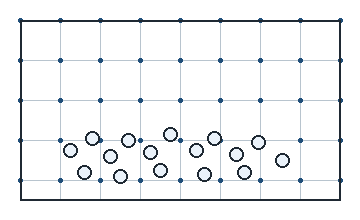

<!-- BRIEFING:UPDATED 2026-11-10 -->
# [시험용 고정물] 수식과 그림이 든 짧은 원고

**지위**: 계획 문서입니다.  아직 계산 결과는 없습니다.  처음 보는 분을 위한 글의 꼴을 시험하는 고정물이고, 실제 계획의 글이 아닙니다.

**한 줄로**: 줄 수식 둘 · 글 안 수식 · 그림 하나가 docx 와 화면에 들어가는지 봅니다.  기공률은 $\phi = 1 - \frac{V_s}{A\,h}$ 로 셉니다.

## 1. 수식

물질점법 (MPM) 은 재료를 점 $p$ 들로 나누고 격자 마디 $i$ 에서 운동량을 풉니다.  이 고정물의 검토 문장: 방향은 맞다.  판정 규칙 몇 개는 고쳐야 한다.

$$
m_i\frac{d\mathbf{v}_i}{dt}=\sum_{p=1}^{N_p}\left(-V_p\,\boldsymbol{\sigma}_p\nabla w_{ip}\right)+m_i\mathbf{g} \tag{1}
$$

- 마디 질량은 $m_i=\sum_p w_{ip}m_p$ 입니다.
- 한 줄로 쓴 줄 수식도 받습니다.

$$ \phi = 1 - \frac{V_s}{A\,h} $$

1. 원의 넓이는 $A = \pi r^2$ 입니다.
2. 수식이 없는 줄입니다.

## 2. 그림

{width=60%}

그림 아래에 이어지는 문단입니다.

## 3. 표

| 용어 | 뜻 |
|---|---|
| 기공률 $\phi$ | 고체가 차지하지 않은 부피의 몫 |
| 마디 질량 | $m_i=\sum_p w_{ip}m_p$ 로 셉니다 |
